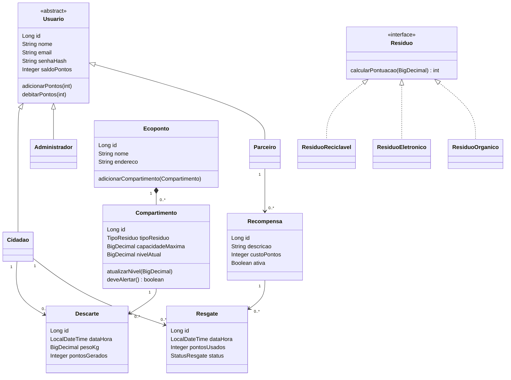
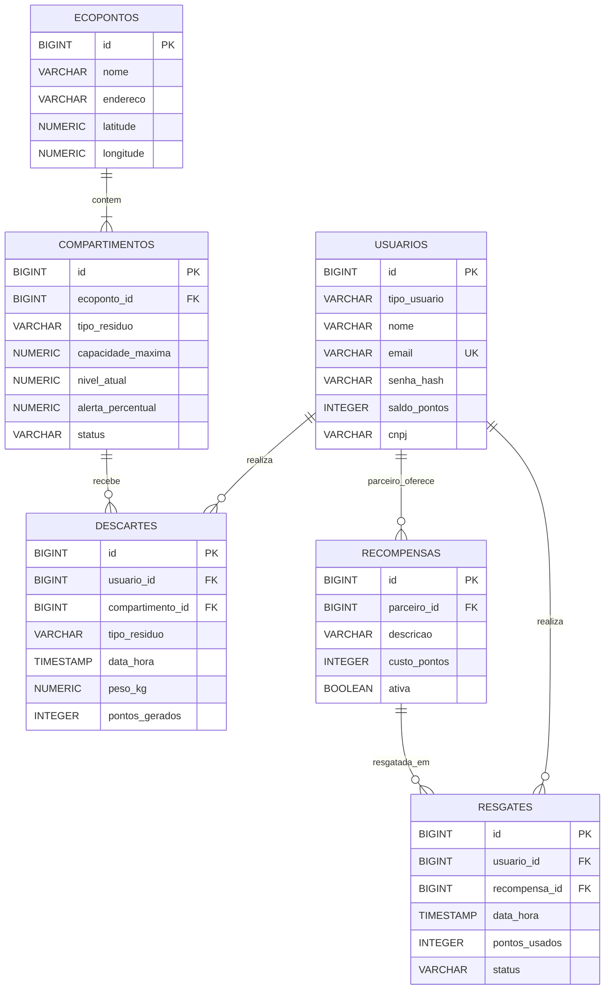

# Arquitetura e implementação - EcoPonto Inteligente

## 1. Visão geral

A aplicação utiliza arquitetura em camadas. A API REST recebe as solicitações; os controladores validam a entrada e delegam as operações aos serviços; os serviços aplicam as regras do negócio e controlam as transações; os repositórios acessam o PostgreSQL por meio do Spring Data JPA; as entidades representam o domínio.

## 2. Camadas

| Camada | Pacote | Responsabilidade |
|---|---|---|
| Configuração | `config` | Segurança, codificação de senha e criação do administrador inicial |
| Controladores | `controller` | Endpoints REST, autenticação HTTP e autorização por perfil |
| DTOs | `dto` | Contratos de entrada e saída da API |
| Entidades | `domain.entity` | Estado e relacionamentos persistidos |
| Enumerações | `domain.enums` | Perfis, tipos de resíduos e estados de resgate |
| Estratégias | `domain.strategy` | Cálculo polimórfico de pontuação |
| Repositórios | `repository` | Consultas e operações de persistência |
| Serviços | `service` | Regras de negócio e transações |

## 3. Modelo de objetos

- `Usuario` é abstrata e implementa `UserDetails`.
- `Cidadao`, `Administrador` e `Parceiro` herdam de `Usuario`.
- `Ecoponto` contém uma lista de `Compartimento` (composição 1:N).
- `Descarte` associa um `Cidadao` a um `Compartimento` e registra tipo, peso, data/hora e pontos.
- `Recompensa` pertence a um `Parceiro`.
- `Resgate` associa o `Cidadao` à `Recompensa` resgatada.
- `Residuo` define o contrato de pontuação; as três classes concretas implementam o cálculo com `@Override`.

## 4. Transação de descarte

1. A API identifica o cidadão autenticado.
2. O serviço localiza o compartimento no banco.
3. A categoria solicitada precisa ser a mesma aceita pelo compartimento.
4. `ResiduoFactory` seleciona a estratégia de pontuação.
5. O domínio confere a capacidade disponível do compartimento.
6. O saldo do cidadão e o nível do compartimento são atualizados.
7. O descarte é gravado no PostgreSQL dentro da mesma transação.

Se alguma validação falhar, a transação é revertida.

## 5. Transação de resgate

1. O cidadão autenticado seleciona uma recompensa ativa.
2. O serviço consulta o saldo persistido.
3. A entidade `Usuario` impede o débito quando o saldo é insuficiente.
4. O saldo e o registro de resgate são persistidos na mesma transação.

## 6. Persistência e relacionamentos

O schema está versionado pelo Flyway. A aplicação usa `spring.jpa.hibernate.ddl-auto=validate`, portanto o Hibernate valida as entidades contra as tabelas existentes em vez de substituir o script de criação. O SQL de referência também está em `database/schema.sql`.

## 7. Segurança

As senhas são armazenadas com BCrypt. O cadastro público aceita somente cidadão e parceiro. O administrador inicial é provisionado por variáveis de ambiente. As rotas são protegidas por HTTP Basic e as operações de administração, parceiro e cidadão são autorizadas por papel.

## 8. Políticas configuráveis

As taxas de pontuação e o limiar de alerta são premissas de implementação para tornar o protótipo executável. Elas não foram fixadas no escopo original e devem ser validadas pela equipe.

## 9. Diagrama de classes (visão da implementação)

## 10. Diagrama relacional (DER em texto)

A tabela `usuarios` utiliza a coluna discriminadora `tipo_usuario` para a herança `SINGLE_TABLE`. As referências `parceiro_id` e `usuario_id` apontam para essa tabela compartilhada; as regras de serviço garantem que o perfil correto execute a operação.
